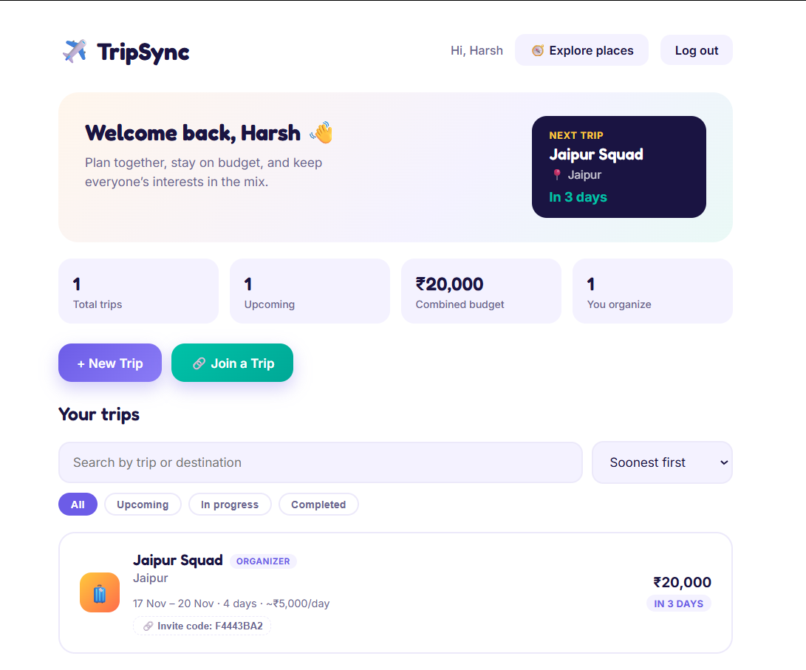
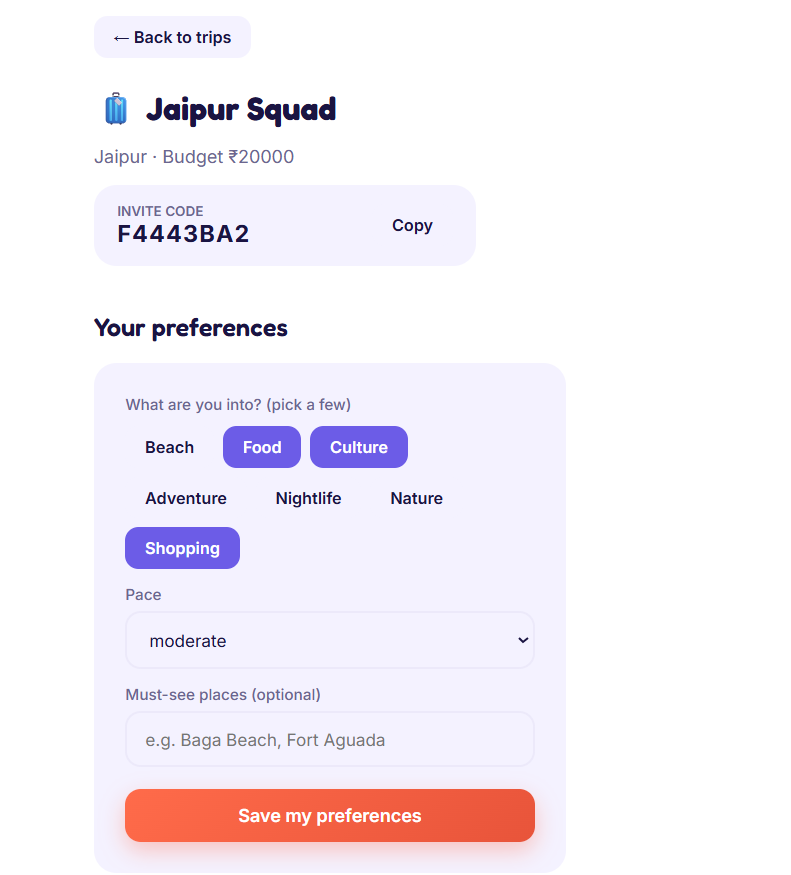
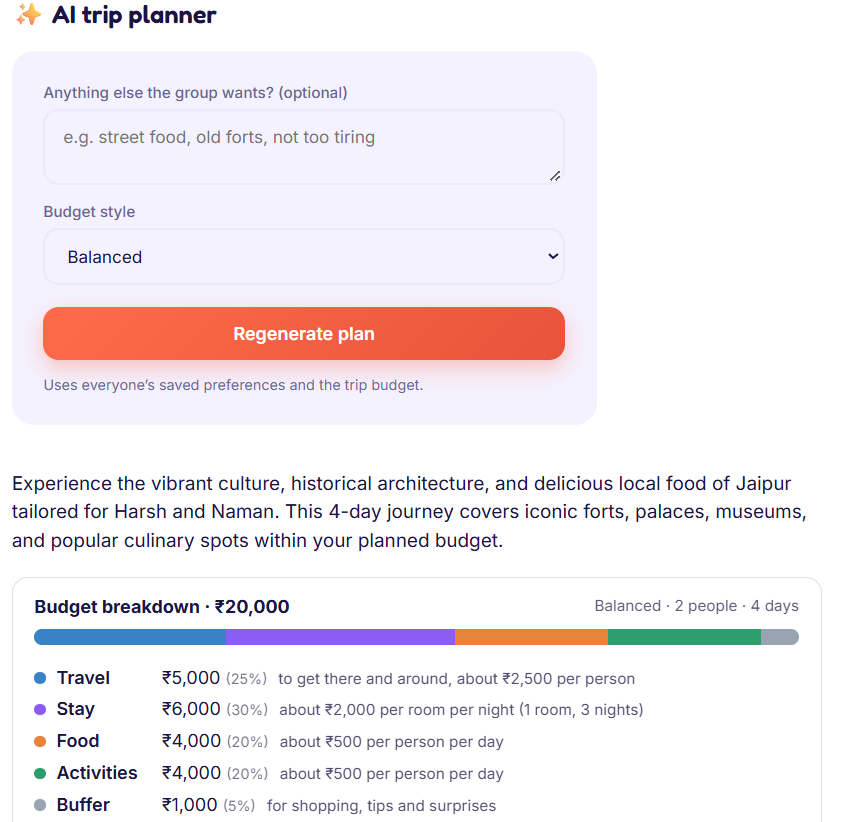
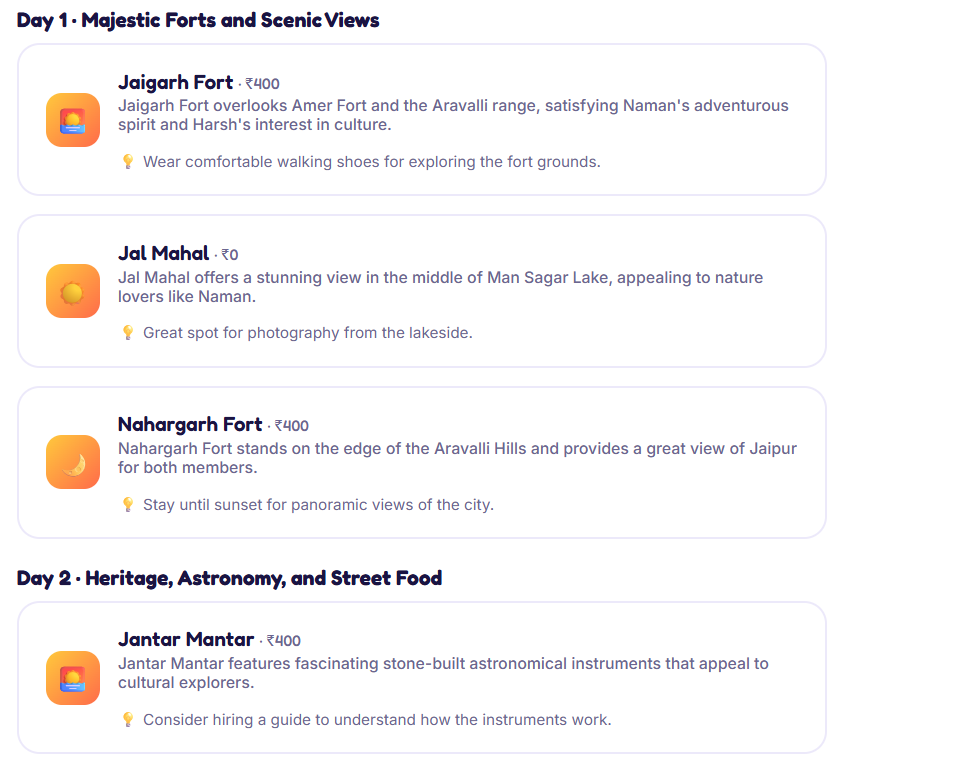
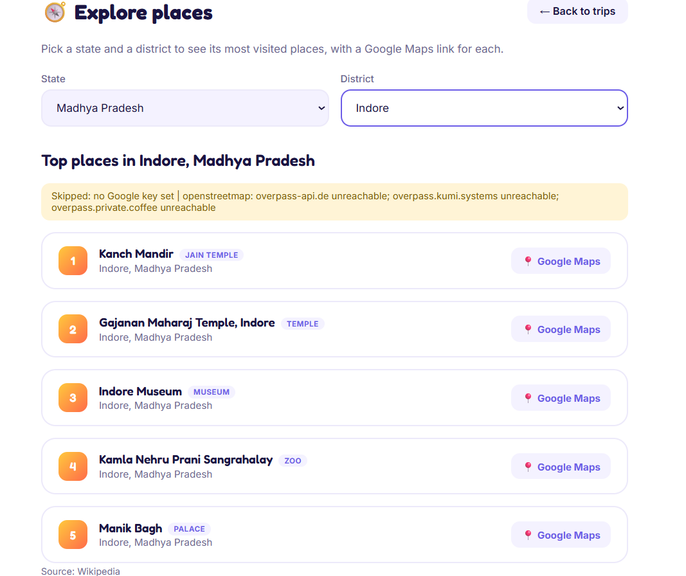
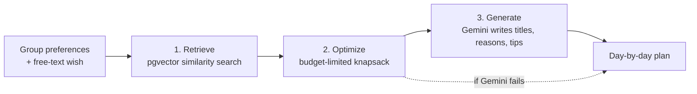

# TripSync

**An AI-powered group trip planner.** Everyone in the group says what they like, and TripSync builds one day-by-day plan that fits the shared budget, with a budget breakdown for travel, stay, food and activities.

> **Live demo:** https://tripsync-kappa-pearl.vercel.app  
> _The free backend sleeps when idle, so the first request after a pause can take 30 to 60 seconds._ 

## What it does

- **Group trips.** Create a trip with a destination and budget, then invite friends with a code.
- **Preferences per person.** Each member picks interests (food, culture, adventure…), a pace (relaxed / moderate / packed) and must-see places.
- **AI trip planner.** One click builds a plan for the whole group. You can add a free-text wish such as "street food and old forts, not too tiring".
- **Budget breakdown.** The total budget is split into travel, stay, food, activities and a buffer, in three styles (budget-friendly, balanced, comfortable), with per-person and per-night figures and warnings when a category looks tight.
- **Works for any destination.** Places are fetched automatically from OpenStreetMap and Wikipedia, so no paid API key is needed.
- **Explore.** Browse the most visited places of any Indian state and district, with Google Maps links.

## Screenshots

| Dashboard | Group preferences |
|---|---|
|  |  |

| AI plan and budget breakdown | Day-by-day plan |
|---|---|
|  |  |

| Explore places |
|---|
|  |

## How the AI planner works

The AI never decides the numbers. The plan comes from three stages, and the language model only writes text:



1. **Retrieve (RAG).** Places are embedded with Gemini and stored in PostgreSQL with **pgvector**. The group's interests and request are embedded too, and the closest places become the candidates. Must-see places are always kept.
2. **Optimize.** `optimizer.py` scores places by how much the group likes them (70% average liking, 30% the least-happy member, so nobody is ignored), then picks the best set that fits the activities budget with an exact 0/1 knapsack, forces must-sees in, and orders stops by distance into days.
3. **Generate.** Gemini receives the already-chosen itinerary and writes a title for each day, a one-sentence reason and a tip for each stop. Days, order and costs are fixed by the optimizer, and any place the model invents is ignored.

If Gemini is unavailable (quota, overload, no key), the app retries up to three times and then still returns the optimizer's plan with a warning, so the page never breaks.

## Tech stack

| Part | Technology |
|---|---|
| Frontend | React 18, **TypeScript (strict)**, Vite, React Router |
| Backend | Python, FastAPI, SQLAlchemy, Alembic |
| Database | PostgreSQL (hosted on Supabase) with **pgvector** |
| AI | Google Gemini API (embeddings + text generation) |
| Places data | OpenStreetMap (Nominatim, Overpass), Wikipedia; Google Places is optional |
| Auth | JWT, bcrypt password hashing |
| Tests | pytest (100+ tests) and `tsc` strict type checking |

## Project structure

```
tripsync/
├── backend/
│   ├── main.py                 API routes: auth, trips, members, preferences
│   ├── routes_ai.py            AI plan endpoint (retrieve -> optimize -> generate)
│   ├── ai_planner.py           embeddings, prompt, Gemini calls, retries
│   ├── optimizer.py            scoring + knapsack + scheduling (pure Python)
│   ├── budget_breakdown.py     travel / stay / food / activities split
│   ├── destination_places.py   fetch places for any destination (no API key)
│   ├── explore_service.py      Explore page data (Google / OSM / Wikipedia)
│   ├── models.py, schemas.py   database models and API schemas
│   ├── alembic/                database migrations
│   └── test_*.py               unit tests
└── frontend/
    └── src/
        ├── pages/              Dashboard, TripDetail, Explore, Login, Signup
        ├── components/         BudgetBreakdown
        ├── api/                typed API client
        └── types.ts            shared TypeScript types
```

## Run it locally

You need **Python 3.11+**, **Node 18+**, a PostgreSQL database (a free Supabase project works) and a free Gemini API key from [Google AI Studio](https://aistudio.google.com/apikey).

### 1. Backend

```bash
cd backend
python -m venv venv
venv\Scripts\activate            # Windows. On macOS/Linux: source venv/bin/activate
pip install -r requirements.txt
cp .env.example .env             # Windows: copy .env.example .env
```

Open `backend/.env` and fill in your own values (see the table below). Then:

```bash
alembic upgrade head             # creates the tables and enables pgvector
python seed_places.py            # optional: sample places for Jaipur
uvicorn main:app --reload
```

The API runs at http://localhost:8000. Check http://localhost:8000/api/health, and open http://localhost:8000/docs for the interactive API docs.

### 2. Frontend

In a second terminal:

```bash
cd frontend
npm install
npm run dev
```

Open http://localhost:5173, create an account, create a trip, save your preferences and click **Generate AI plan**.

### Environment variables

| Variable | Required | Purpose |
|---|---|---|
| `DATABASE_URL` | yes | PostgreSQL connection string. If your password has symbols, use letters and numbers only or URL-encode it. |
| `JWT_SECRET_KEY` | yes | Long random string used to sign login tokens. |
| `GEMINI_API_KEY` | yes, for AI text | Google AI Studio key. Without it you still get the optimizer's plan. |
| `GEMINI_MODEL` | no | Text model name. Model names change often, so check AI Studio if you see a "not found" error. |
| `GEMINI_FALLBACK_MODEL` | no | Second model to try if the first one keeps failing. |
| `GOOGLE_PLACES_API_KEY` | no | Leave empty to use OpenStreetMap and Wikipedia. |
| `VITE_API_URL` | for deployment | Backend URL for the frontend (defaults to `http://localhost:8000`). |

Never commit `backend/.env`. It is listed in `.gitignore`.

### Tests

```bash
cd backend && python -m pytest -q          # optimizer, budget, places, AI helpers
cd frontend && npm run typecheck           # strict TypeScript check
```

## Known limitations

- **Costs are estimates.** OpenStreetMap and Wikipedia have no prices, so place costs and the budget breakdown come from simple rules and the app says so. There are no live hotel, transport or restaurant prices.
- **Places from free sources have no ratings,** and restaurants are only available when OpenStreetMap's Overpass servers can be reached (they are blocked on some networks, then the app falls back to a search-based lookup and Wikipedia).
- **The Gemini free tier can be busy.** The app retries and falls back, but the AI text may sometimes be missing.
- **API types are compile-time only.** The frontend does not validate responses at runtime.
- **No hotel, transport or expense tracking yet.**

## Roadmap

- Daily meal suggestions and hotel options near each day's stops
- Expense tracking and "who owes whom" for the group
- Runtime response validation on the frontend
- Deployment configuration (Render + Vercel)

## Author

Harsh Vardhan Singh Rajpoot — Samrat Ashok Technological Institute (SATI), Vidisha, B.Tech
